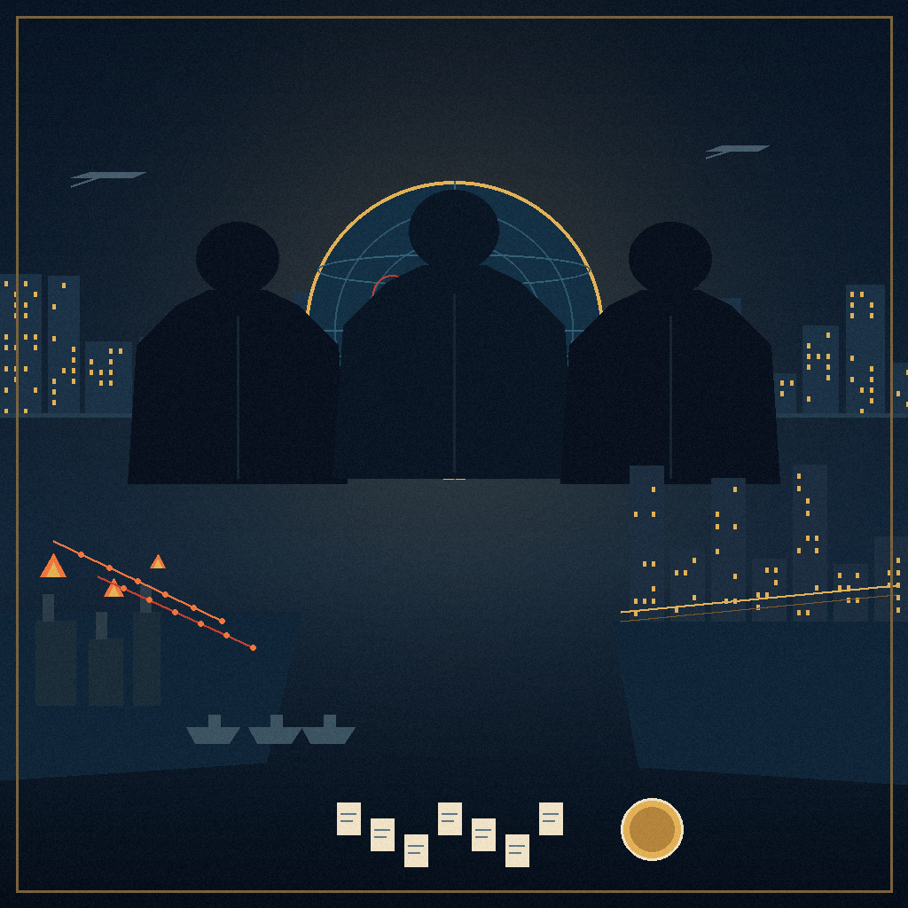

# 19 November 2026, in one image

## The picture

A single 1024x1024 editorial illustration summing up the day's world news,
composed as one collage:

- **Above the globe** — Xi, Trump and Putin at one summit table under an
  "APEC · SHENZHEN" banner: the trilateral diplomacy that set the day's tone.
- **The Gulf** — missile trails arcing over a line of oil tankers; energy
  and escalation sharing the same water.
- **A shattered city** — broken rooftops and rubble, with construction
  cranes already rising beside them: destruction and rebuilding in one
  skyline.
- **Bombers** crossing the upper sky.
- **Ballots and a coin** in the foreground — elections and markets, the two
  ledgers every story eventually lands in.

## Run

    python3 main.py                           # writes /output/entry.png
    MAKEFUN_OUTPUT_DIR=./out python3 main.py  # writes ./out/entry.png

`main.py` is Python 3.13 standard library only: it creates the output
directory, copies the committed `entry.png` from beside the script into it,
and prints the path, byte size and SHA-256 of what it wrote. No network,
deterministic.

## Files

- `entry.png` — the 1024x1024 entry artifact (committed as-is).
- `main.py` — the stdlib-only runner described above.
- `draw.py` — Pillow authoring script with fixed seed `20261119` that draws
  the illustration. Kept for provenance; running it regenerates `entry.png`.
- `.makefun/owner.json` — make.fun owner wallet.
- `LICENSE` — MIT.

Entry for the [make.fun bounty news-image-20261119](https://make.fun/bounty/news-image-20261119).
